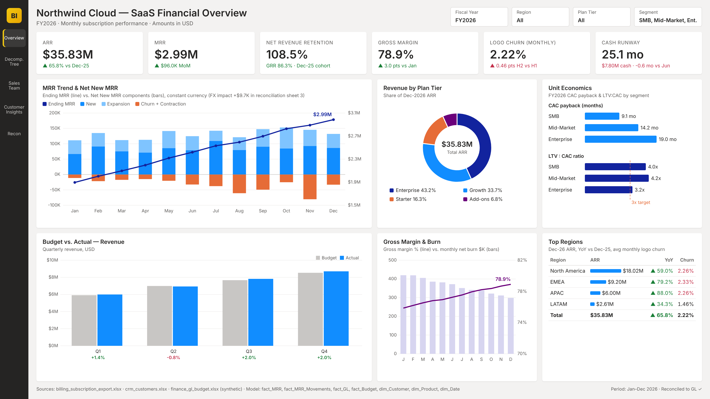
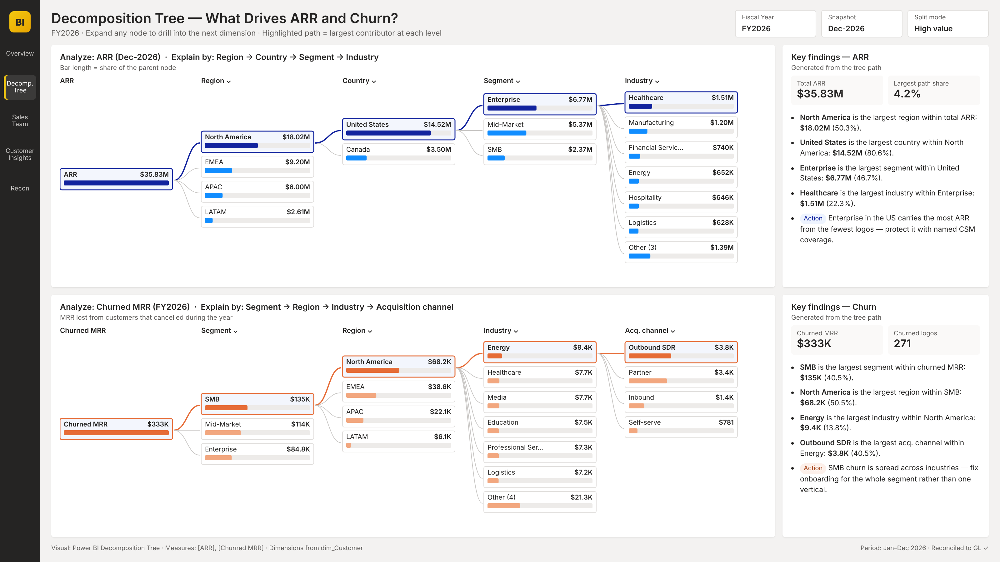
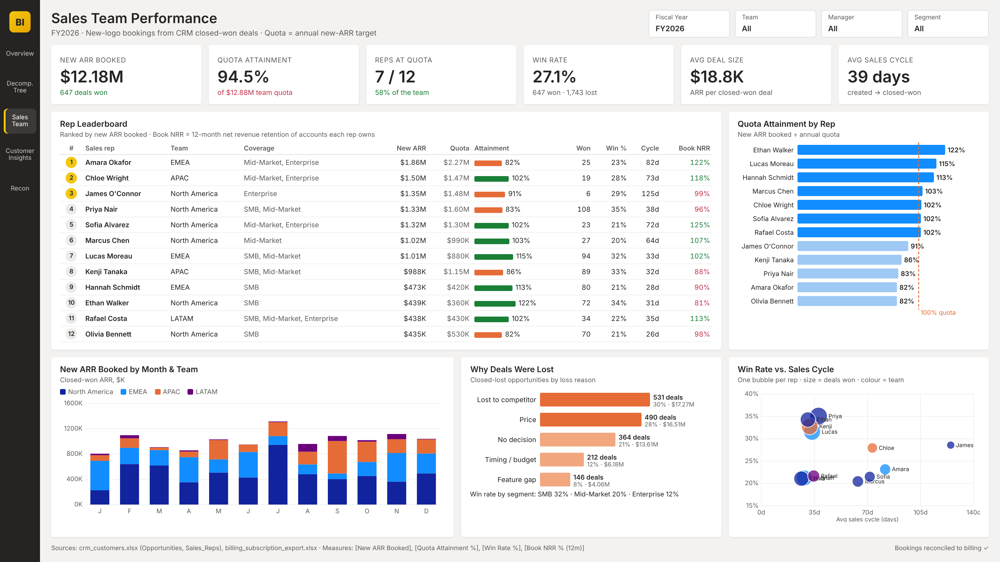
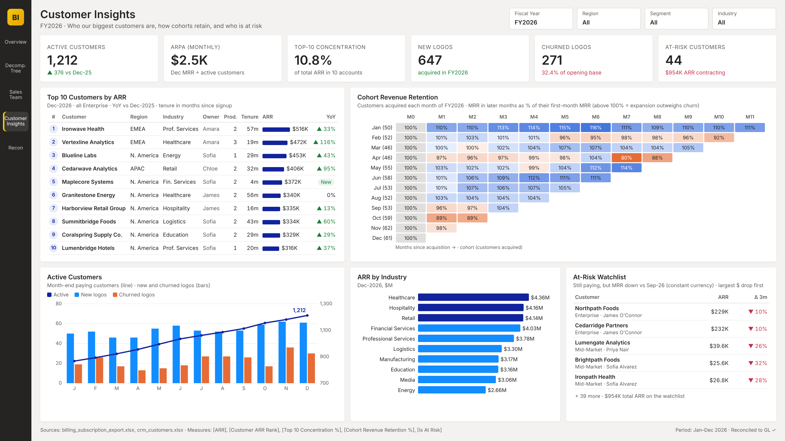
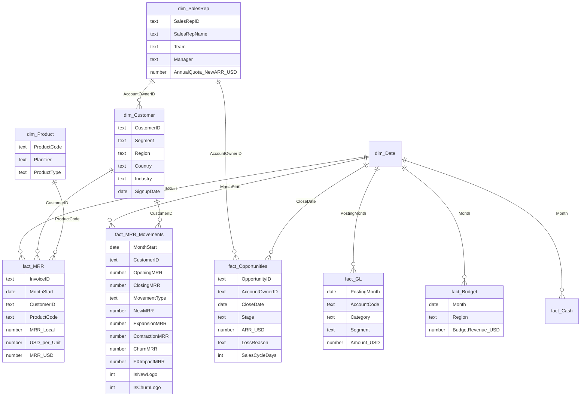

# SaaS Financial Dashboard — Power BI

**Northwind Cloud (fictional B2B SaaS company) · FY2026 · Power BI · Power Query (M) · DAX · Excel**

| Finance Overview | Decomposition Tree |
|---|---|
|  |  |
| **Sales Team Performance** | **Customer Insights** |
|  |  |

> Portfolio project. The screenshots are high-fidelity design mock-ups of the Power BI pages, rendered from the same data the model uses. The company, its customers and every figure here are synthetic. The data is generated by `scripts/generate_data.py`. Everything in this README is computed from the Excel files in `data/raw`, and the checks in the reconciliation workbook tie the dashboard back to those files.

---

## 1. Project description

This is a four-page executive report for a subscription software company: Finance Overview, Decomposition Tree, Sales Team Performance and Customer Insights. It answers four questions: how fast recurring revenue is growing, whether customers stay and expand, whether growth is efficient, and how long the cash lasts. The report combines three systems that did not previously agree with each other:

| Source system | File | What it holds |
|---|---|---|
| Billing platform export | `billing_subscription_export.xlsx` | 18,575 invoice lines: customer × product × month, in 6 local currencies |
| CRM | `crm_customers.xlsx` | 1,483 customers (segment, region, industry, account owner), product catalogue, 12 sales reps with quotas, 2,390 closed won/lost opportunities |
| Finance / ERP | `finance_gl_budget.xlsx` | GL actuals by account, FY2026 revenue budget by region, monthly FX rates, closing cash |

**Headline results (FY2026):** ARR of **$35.83M**, up 65.8% from Dec-25. Net revenue retention is **108.5%**, gross margin reached **78.9%** in December, and cash runway is **25.1 months**. Every figure reconciles to the general ledger (GL) within $0.01.

## 2. Business problem

Before this report, the finance team had no single trusted view of recurring revenue:

- **Three versions of MRR.** Billing reported MRR in local currency. Finance booked USD revenue in the GL. RevOps tracked bookings in the CRM. Month-end meetings were spent arguing about whose number was right.
- **Dirty billing exports.** Re-exported invoices created duplicate lines. QA test accounts were billed $1 a month. Customer IDs were inconsistent (`"  c-00412 "` versus `C-00412`). Together these overstated revenue and broke customer counts.
- **Growth was measured only as a total.** Nobody could tell whether MRR growth came from new logos or from expansion, or how much churn was hiding underneath. Net revenue retention and customer acquisition cost (CAC) payback were calculated by hand once a quarter.
- **Budget variance arrived late.** Actual-versus-budget revenue was built in Excel 10 or more days after month-end, by region, with no drill-down.
- **Sales and finance disagreed on bookings.** Sales reported closed-won ARR from the CRM, finance saw new revenue in billing, and nobody tied the two together. Rep performance was tracked in a separate spreadsheet.
- **No customer-level view.** There was no list of top accounts, no cohort retention and no early warning for accounts that were shrinking.
- **The board pack took 3 days** of manual copy-and-paste every month.

**Goal:** an automated, reconciled Power BI model that refreshes from the three source files. It shows MRR movements, retention, unit economics, margin and burn on one page, and includes a sign-off reconciliation that finance trusts.

## 3. Users and stakeholders

| Role | Involvement | What they use |
|---|---|---|
| **CFO** (project sponsor) | Defined the KPIs and signs off the board pack | KPI cards, runway, gross margin |
| **FP&A Manager** (primary user) | Requirements, KPI definitions, user acceptance testing (UAT) | Budget vs. actual, MRR waterfall, region table |
| **Finance Controller** | Owner and reviewer of the reconciliation | Reconciliation workbook, Recon page |
| **RevOps / Billing Analyst** | Source-data owner for billing and CRM; fixed the root causes of data-quality issues | Duplicate and test-account exception list |
| **VP Sales and sales managers** | Consumers; agreed quota and booking rules | Sales page: leaderboard, attainment, win rate, loss reasons |
| **Head of Customer Success** | Consumer; owns the at-risk follow-up | Customer page: top 10, cohort retention, at-risk watchlist; churn decomposition tree |
| **Board and investors** | Monthly pack recipients | Exported page (PDF) |
| **BI Developer** (me) | Data modelling, Power Query, DAX, report design, reconciliation | — |

## 4. Process: how the project was done

1. **Requirements and KPI dictionary.** Held workshops with the CFO and the FP&A manager and agreed one definition per KPI:
   - **MRR:** a month-end balance.
   - **ARR:** MRR × 12.
   - **NRR:** current MRR from the customers who were paying 12 months ago, divided by what they paid then.
   - **Logo churn:** churned customers ÷ customers at the start of the month.
   - **CAC:** sales and marketing (S&M) spend ÷ new logos.
   - **CAC payback:** CAC ÷ (new-customer ARPA × gross margin).
   - **LTV:** ARPA × gross margin × lifetime, with lifetime capped at 60 months.
2. **Source profiling.** Profiled each file with Power Query column profiling. This found 57 duplicate invoice lines, 18 test-account lines, 140 lines with badly formatted IDs or product codes, and 6 billing currencies.
3. **Staging and cleaning (Power Query).** Built a reusable `fnReadSheet` function and a `pDataFolder` parameter so the files can be repointed. Staging queries trim and upper-case keys, remove exact duplicates, exclude `TEST-` accounts and convert `"2026-03"` to a date. The refresh fails loudly if any line has no FX rate.
4. **Currency conversion.** Each billing line is joined to that month's FX rate, giving `MRR_USD = MRR_Local × USD_per_Unit`.
5. **MRR movement engine.** Built a full customer × month grid, so a customer whose MRR drops to zero shows up as churn instead of disappearing. Each customer-month is classified as New, Expansion, Contraction, Churn or Flat (`fact_MRR_Movements`). Classification is done in **constant currency**. Non-USD customers pay a fixed price in their own currency, so their USD MRR moves every month with the exchange rate. Comparing USD month to month would book those moves as upsells or downgrades, so the comparison uses the billing currency and the exchange-rate effect is reported as its own FX Impact line.
6. **Star schema.** Built facts at their natural grain, added conformed dimensions and a marked date table, and used single-direction relationships. Segment and region are pushed to the GL and budget tables with `TREATAS` instead of bi-directional filters.
7. **DAX measures.** Wrote about 65 measures in a `_Measures` table, covering semi-additive balances, cohort retention, unit economics and budget variance.
8. **Reconciliation.** Built a six-check sign-off workbook (section 7). The report is not published until all checks show PASS.
9. **Report design.** Four pages, each answering one audience's questions (section 8). Slicers cover year, region, plan tier, segment, team and industry.
10. **UAT and handover.** FP&A validated three months against their Excel workings. RevOps fixed duplicate exports and test accounts at the source. A scheduled refresh replaced the manual pack.

## 5. Data model



`fact_GL[Segment]` and `fact_Budget[Region]` are joined virtually to `dim_Customer` with `TREATAS` inside the measures.

## 6. Power Query (M) and DAX

The full code is in [`powerbi/power_query.m`](powerbi/power_query.m) (14 queries) and [`powerbi/measures.dax`](powerbi/measures.dax) (about 65 measures).

### Power Query highlights

**Cleaning the billing export**

```m
CleanKeys  = Table.TransformColumns(Typed, {
                {"CustomerID",  each Text.Upper(Text.Trim(_)), type text},
                {"ProductCode", each Text.Upper(Text.Trim(_)), type text}}),
Deduped    = Table.Distinct(CleanKeys),                                        // re-exported invoice lines
NoTest     = Table.SelectRows(Deduped, each not Text.StartsWith([CustomerID], "TEST-")),
MonthStart = Table.AddColumn(NoTest, "MonthStart", each Date.FromText([BillingPeriod] & "-01"), type date)
```

**FX conversion with a hard failure on a missing rate**

```m
CheckFX = if Table.RowCount(Table.SelectRows(ExpandFX, each [USD_per_Unit] = null)) > 0
          then error "Missing FX rate for one or more billing lines" else ExpandFX,
AddUSD  = Table.AddColumn(CheckFX, "MRR_USD", each [MRR_Local] * [USD_per_Unit], type number)
```

**MRR movement classification.** The customer × month grid is joined to itself on the prior month, and the comparison is made in local currency so FX moves are not counted as expansion or contraction:

```m
Grid    = Table.ExpandListColumn(Table.AddColumn(Customers, "MonthStart", each Months), "MonthStart"),
JoinPrev = Table.NestedJoin(ExpCurr, {"CustomerID","PrevMonth"}, CustMonth, {"CustomerID","MonthStart"}, "Prev", JoinKind.LeftOuter),
AddType = Table.AddColumn(AddDelta, "MovementType", each
            if [OpeningLocal] <= Eps then "New" else if [ClosingLocal] <= Eps then "Churn"
            else if [DeltaLocal] > Eps then "Expansion"
            else if [DeltaLocal] < -Eps then "Contraction" else "Flat", type text),
AddExp  = Table.AddColumn(AddNew, "ExpansionMRR", each if [MovementType] = "Expansion" then [DeltaLocal] * [ClosingRate] else 0, type number),
AddFX   = Table.AddColumn(AddChurn, "FXImpactMRR", each                      // pure exchange-rate effect
            if [MovementType] = "New" or [MovementType] = "Churn" then 0
            else [ClosingMRR] - [OpeningMRR] - [DeltaLocal] * [ClosingRate], type number)
```

### Key DAX measures

```dax
Closing MRR =                       -- MRR is a balance: take the last month in context
CALCULATE ( [MRR Amount], LASTNONBLANK ( dim_Date[Date], [MRR Amount] ) )

ARR = [Closing MRR] * 12

NRR % (12m) =
VAR EndMonth   = MAX ( fact_MRR[MonthStart] )
VAR StartMonth = EDATE ( EndMonth, -12 )
VAR Cohort     = CALCULATETABLE ( VALUES ( fact_MRR[CustomerID] ), REMOVEFILTERS ( dim_Date ), fact_MRR[MonthStart] = StartMonth )
VAR StartMRR   = CALCULATE ( [MRR Amount], REMOVEFILTERS ( dim_Date ), fact_MRR[MonthStart] = StartMonth )
VAR EndMRR     = CALCULATE ( [MRR Amount], REMOVEFILTERS ( dim_Date ), fact_MRR[MonthStart] = EndMonth, Cohort )
RETURN DIVIDE ( EndMRR, StartMRR )

Net New MRR = [New MRR] + [Expansion MRR] - [Contraction MRR] - [Churned MRR]

S&M Spend =                         -- lets the customer Segment slicer filter GL spend
CALCULATE ( SUM ( fact_GL[Amount_USD] ), fact_GL[Category] = "OpEx - S&M",
            TREATAS ( VALUES ( dim_Customer[Segment] ), fact_GL[Segment] ) )

CAC Payback (months) = DIVIDE ( [CAC], [New Customer ARPA] * [Gross Margin % (all segments)] )

Cash Runway (months) =
VAR LastMonth = CALCULATE ( MAX ( fact_GL[PostingMonth] ) )
VAR Cash      = CALCULATE ( SUM ( fact_Cash[ClosingCash_USD] ), REMOVEFILTERS ( dim_Date ), fact_Cash[Month] = LastMonth )
VAR AvgBurn3M = CALCULATE ( [Net Burn], DATESINPERIOD ( dim_Date[Date], EOMONTH ( LastMonth, 0 ), -3, MONTH ) ) / 3
RETURN DIVIDE ( Cash, AvgBurn3M )

MRR Roll-forward Check = ROUND ( [Opening MRR] + [Net New MRR] + [FX Impact MRR] - [Closing MRR], 2 )   -- must be 0

-- Sales page
Win Rate % = DIVIDE ( [Deals Won], [Deals Won] + [Deals Lost] )
Quota Attainment % = DIVIDE ( [New ARR Booked], [Quota (New ARR)] )      -- quota pro-rated to the months selected
Rep Rank (New ARR) = RANKX ( ALL ( dim_SalesRep[SalesRepName] ), [New ARR Booked], , DESC, DENSE )

-- Customer page
Top 10 Customers ARR = CALCULATE ( [ARR], TOPN ( 10, ALLSELECTED ( dim_Customer[CustomerName] ), [ARR], DESC ) )
Top 10 Concentration % = DIVIDE ( [Top 10 Customers ARR], CALCULATE ( [ARR], ALLSELECTED ( dim_Customer ) ) )
Is At Risk =                                   -- still paying, MRR down vs 3 months ago in constant currency
VAR Now_ = [MRR Local Latest]  VAR Then_ = [MRR Local 3 Months Ago]
RETURN IF ( Now_ > 0 && Now_ < Then_ - 0.005, 1, 0 )
Cohort Revenue Retention % =                   -- matrix: rows = SignupCohort, columns = month
VAR CohortStart = MIN ( dim_Customer[SignupCohort] )
VAR CohortMRR   = CALCULATE ( [MRR Amount], REMOVEFILTERS ( dim_Date ), fact_MRR[MonthStart] = CohortStart )
RETURN IF ( MAX ( dim_Date[MonthStart] ) >= CohortStart,
            DIVIDE ( CALCULATE ( [MRR Amount], REMOVEFILTERS ( dim_Date ), fact_MRR[MonthStart] = MAX ( dim_Date[MonthStart] ) ), CohortMRR ) )
```

## 7. How results were reconciled

The workbook [`data/reconciliation/reconciliation_checks.xlsx`](data/reconciliation/reconciliation_checks.xlsx) is the month-end sign-off. It contains 219 live formulas. Blue cells are values pasted from the sources or from the model, black cells are formulas, and tolerances live on the `Controls` tab. Every check currently passes.

| # | Check | Method | FY2026 result |
|---|---|---|---|
| 1 | **Billing export → model rows** | Raw rows − duplicates − test accounts = rows in `fact_MRR`, month by month | 18,575 − 57 − 18 = **18,500** = model ✅ |
| 2 | **Model revenue → GL** | `[Subscription Revenue]` vs. GL account 4000 per month; tolerance $1 for cent rounding after FX | $29,460,264.45 vs. $29,460,264.46, difference **$0.01** ✅ |
| 3 | **MRR roll-forward** | Opening + New + Expansion − Contraction − Churn + FX = Closing; each opening = prior closing | $1.80M + $1,014,753 + $564,968 − $70,561 − $333,455 + $9,717 FX = **$2,985,764** ✅ |
| 4 | **Customer master and keys** | Billed customers exist in the CRM (no orphans); every line has an FX rate; test revenue excluded | 1,483 = 1,483, 0 orphans, 0 missing rates ✅ |
| 5 | **Dashboard KPI tie-out** | ARR, FY revenue, MRR change and budget re-derived from sheets 1–4 | All within tolerance ✅ |
| 6 | **CRM bookings → billing** | Closed-won deals and ARR on the Sales page vs. new logos and new MRR × 12 in billing, by month | 647 = 647 deals; $12,177,040.32 vs. $12,177,040.29 (**$0.03**, FX cent rounding) ✅ |

The Power BI file also includes a hidden **Recon** page that uses `Recon | Model vs GL Revenue` and `Recon | Status` by month, so the check can be repeated after every refresh.

**Exceptions found and resolved**

- **57 duplicate invoice lines** came from billing re-exports. They are removed in Power Query, and RevOps fixed the export job.
- **18 lines from two QA test accounts**, billed $1 a month from April, are excluded. The billing team flagged the accounts as internal.
- **140 lines had untrimmed or lower-case IDs and codes.** Without normalisation they would have failed to join to the CRM and silently dropped revenue.
- **FX noise in the movement bridge.** Non-USD customers pay fixed local prices, so comparing USD month to month made exchange-rate moves look like expansion or contraction. Movements are classified in constant currency, with a separate FX Impact line (+$9.7K for FY2026).
- **The $0.01 FY difference against the GL** comes from the GL posting rounded to cents after FX. This is documented and within the $1 tolerance.

## 8. Report pages and insights

**Page 1 — Finance Overview** (CFO, board): ARR, MRR, NRR, gross margin, churn and runway; the MRR bridge; plan-tier mix; unit economics; budget vs. actual; margin and burn; regions.
- Growth comes mainly from new logos: new MRR of $1.01M was about 1.8 times expansion ($565K). NRR of 108% is healthy but leaves room to improve.
- Revenue beat budget by 1.2% ($29.46M vs. $29.11M); Q2 was the only quarter under, by 0.8%.
- Gross margin rose 3.0 points (75.9% to 78.9%) and monthly net burn fell from about $420K to about $300K.

**Page 2 — Decomposition Tree** (FP&A, CS leadership): two Power BI decomposition trees. ARR is split by Region → Country → Segment → Industry, and churned MRR by Segment → Region → Industry → Acquisition channel.
- North America holds 50.3% of ARR, the United States 80.6% of that, and US Enterprise alone $6.77M.
- SMB is the largest source of churned MRR ($135K, 40.5%), and SMB churn is spread evenly across industries. This points to an onboarding problem for the whole segment, not one vertical.

**Page 3 — Sales Team Performance** (VP Sales, managers): bookings, quota attainment, win rate, deal size and sales cycle; a 12-rep leaderboard; attainment chart; bookings by team; loss reasons; win rate vs. cycle.
- The team booked $12.18M new ARR, 94.5% of its $12.88M quota; 7 of 12 reps hit quota.
- The top booker (Amara Okafor, $1.86M) is at only 82% of a large quota, while the best attainment (Ethan Walker, 122%) is on a small SMB quota. Ranking by dollars and by attainment tells different stories.
- Competitors (30%) and price (28%) cause most losses. Enterprise wins only 12% of deals against 32% for SMB.

**Page 4 — Customer Insights** (Customer Success, account managers): top 10 customers, cohort retention heatmap, active customers trend, ARR by industry and an at-risk watchlist.
- Active customers grew from 836 to 1,212. The top 10 accounts, all Enterprise, hold 10.8% of ARR, so concentration risk is low.
- The January cohort retains 111% of its first-month revenue; the April and October cohorts dropped below 90% within months. Those onboarding periods are worth reviewing.
- 44 customers ($954K ARR) are shrinking in constant currency versus September. Two Enterprise accounts owned by James O'Connor lead the list.

## 9. Repository structure

```
saas-financial-dashboard/
├── README.md
├── images/                                screenshots of the 4 report pages
├── data/
│   ├── raw/                                Excel source files (the model reads these)
│   │   ├── billing_subscription_export.xlsx
│   │   ├── crm_customers.xlsx
│   │   └── finance_gl_budget.xlsx
│   ├── processed/                          independent recomputation (metrics, movements, unit economics, rep performance, top 10)
│   └── reconciliation/reconciliation_checks.xlsx
├── powerbi/
│   ├── power_query.m                       all Power Query queries
│   └── measures.dax                        all DAX measures
├── dashboard/                              HTML design mock-ups of the 4 pages (page*.html + shared.css/js)
└── scripts/
    ├── generate_data.py                    builds the synthetic Excel sources (seeded)
    ├── compute_metrics.py                  recomputes every KPI from the Excel files
    ├── build_reconciliation.py             builds the reconciliation workbook
    └── render_dashboard.py                 renders the 4 page screenshots into images/
```

## 10. How to reproduce

1. Open Power BI Desktop, then go to **Transform data → Manage parameters** and set `pDataFolder` to your `data\raw\` folder.
2. Create each query from `powerbi/power_query.m`. Turn off **Enable load** for `stg_Billing`, `stg_FX` and `fnReadSheet`.
3. Mark `dim_Date` as a date table on `[Date]` and create the relationships listed at the top of `measures.dax`.
4. Add the measures from `measures.dax` to a `_Measures` table.
5. Compare the card values with `data/reconciliation/reconciliation_checks.xlsx`. They should match to the cent.

To regenerate the data and outputs:

```bash
python scripts/generate_data.py
python scripts/compute_metrics.py
python scripts/build_reconciliation.py
python scripts/render_dashboard.py
```

---
*Author: Muhammad Hassan · [LinkedIn](https://www.linkedin.com/in/moh23) · [GitHub](https://github.com/msamhassan)*
